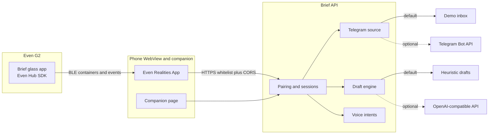

# Brief

Glanceable Telegram briefing and one-tap replies for [Even G2](https://www.evenrealities.com/) glasses.

Brief answers a small everyday moment: you glance up, see what matters in Telegram, and send a short reply without taking out your phone. It is built for the Heads Up: Even Realities hackathon, **Messaging & News** track, and is also in scope for the Best Telegram integration prize.

The glasses never hold API keys. They talk only to a small Brief API you run. The default inbox is a realistic demo so you can record a walkthrough with no Telegram login and no paid services. A live Telegram Bot API adapter is included and stays opt-in.

## What you see on the glasses

1. A pairing code.
2. A 30-second briefing of unread chats, one highlight selected.
3. The last few messages in that thread.
4. A short draft reply. Tap to send, swipe for another wording, or speak an instruction such as “tell them I’m running late.”

Double-tap the home briefing to leave. The app uses the system exit-confirmation dialog, as Even Hub QA requires.

## Architecture



The G2 display is not HTML. Brief composes official Even Hub text containers on a 576×288 canvas (header, body, footer), with a contextual menu for Draft, Listen, Next, and Mark seen. Input is the temple or R1 ring: tap, double-tap, swipe, and long-press to listen.

## Repository layout

```
apps/glass          Even Hub Vite app (SDK 0.0.16)
services/api        Pairing, briefing, drafts, voice, companion page
packages/shared     Pure domain logic used by the app, API, and tests
tools/demo-frames   Official screen specs exported to PNG and a short video
demo                Screenshots and walkthrough
```

## Prerequisites

- Node.js 20 or later
- Even Hub simulator (optional, for a live glasses window):

```bash
npm install -g @evenrealities/evenhub-cli @evenrealities/evenhub-simulator
```

## Run the demo

```bash
npm install
cp .env.example .env
npm test
npm run dev:api      # http://127.0.0.1:8787/companion
npm run dev:glass    # http://localhost:5173
```

In a third terminal, if the simulator is installed and you have a display:

```bash
npx evenhub-simulator http://localhost:5173
```

1. The glasses show a four-character code.
2. Open http://127.0.0.1:8787/companion on your phone or laptop and enter the code.
3. Choose **Start demo inbox**.
4. Tap through briefing → thread → draft → send. Swipe to move. Hold or use the menu to listen.

To regenerate demo frames:

```bash
npm run demo:frames
python3 tools/demo-frames/render.py
```

Screenshots land in `demo/frames/`. A silent walkthrough video is written to `demo/brief-walkthrough.mp4`.

## Optional live integrations

None of these are required to run or judge the demo.

| Variable | Purpose |
| --- | --- |
| `TELEGRAM_BOT_TOKEN` | Official Telegram Bot API. The bot can see DMs sent to it and channel posts if it is an admin. Personal Telegram inboxes are not readable through Bot API, which is why demo mode is the default. |
| `OPENAI_API_KEY` | Optional OpenAI-compatible draft endpoint. If unset, Brief uses the built-in deterministic draft engine. |
| `WHISPER_URL` | Optional speech-to-text endpoint. The demo and tests accept a transcript (and a companion/voice injector). Glasses still capture 16 kHz mono PCM, as the SDK provides it. |

Copy `.env.example` and fill only what you need. Never put secrets in `app.json` or the glass app.

When you deploy the API, add its HTTPS origin to `apps/glass/app.json` under the `network` permission whitelist. The whitelist is not a CORS bypass; the API already sends `Access-Control-Allow-Origin`.

## Commands

| Command | What it does |
| --- | --- |
| `npm test` | Unit and API tests |
| `npm run typecheck` | TypeScript across workspaces |
| `npm run dev:api` | Brief API and companion page |
| `npm run dev:glass` | Vite dev server for the glasses app |
| `npm run demo:frames` | Export official screen specs |
| `npm run pack -w @brief/glass` | Package a `.ehpk` with `evenhub pack` (requires the Even Hub CLI) |

## What existed before 23 November 2026

The Even Hub SDK, CLI, simulator, official templates, and documentation are Even Realities’ work. Vite, TypeScript, Vitest, and Node.js are third-party tools. Every Brief application file in this repository — the glass app, API, pairing flow, demo inbox, draft engine, voice intents, tests, and demo frames — was written for this hackathon.

## Safety

- No Telegram message is sent until you approve a draft with a tap (or an explicit “send” voice command).
- API keys never ship inside the glasses app.
- Demo data is fixture data. It is not a live inbox.
- Channel highlights in the demo are read-only style announcements; there is no trading, custody, or financial advice.

## Licence

MIT. See [LICENSE](LICENSE).
